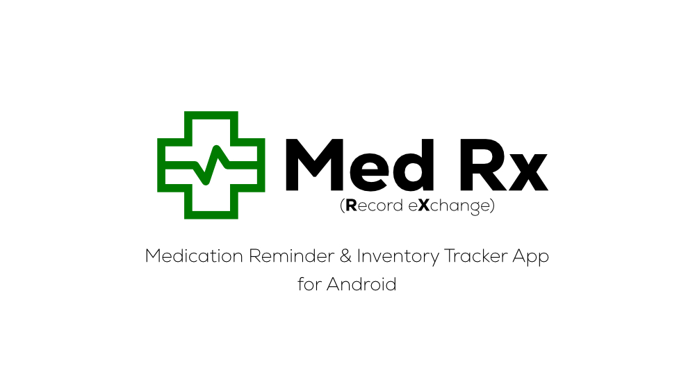

# Med Rx (Record eXchange)

**Accurate medication tracking, resilient supply ledgers, and honest adherence data.**

Med Rx is an independent, community-driven fork of [Med by FeDeveloper95](https://github.com/FeDeveloper95/Med) (licensed under Apache 2.0). Maintained by [nukirk](https://github.com/nufuturepro), it is not affiliated with or endorsed by the original upstream project.

Where upstream acts primarily as a reminder tool, Med Rx engineers the entire lifecycle around the dose: deliberate skipping logic, auditable inventory tracking, historical data integrity, and dependable recovery tooling.

## Key Distinctions from Upstream

- **Clinical Dose Skipping & Pre-Skips** — Log intentional skips directly from notifications, alarms, or med cards using standardized clinical reason chips and notes. Plan ahead for travel, fasting, or clinical procedures by pre-skipping future intervals without corrupting scheduled adherence metrics.
- **Snooze Discipline** — A snooze limit that actually ends the loop: after a configurable number of snoozes the dose is recorded as skipped or postponed to its next slot, so a reminder that keeps getting pushed can never quietly disappear from your adherence data.
- **Skips You Can Audit and Correct** — Every skip keeps its clinical reason, timestamp and note, shown right on the med card. The note stays editable afterwards, so fixing a hurried note never means un-skipping a dose and starting over.
- **Auditable, Idempotent Supply Ledger** — Every inventory shift (doses, manual corrections, refills, returns) writes an immutable ledger entry with running balances. Idempotent logging ensures double-taps between phone, notifications, or connected wearables never deduct stock twice.
- **Guarded History & Architecture** — Editing complex dose groups or past regimens can no longer corrupt previous taken history. Dose-update state resolution is isolated in a standalone MedUpdatePlanner pipeline.
- **PRN (As-Needed) Support** — Full support for non-scheduled, ad-hoc medication logging with dedicated collapsible home surface trays.
- **Doctor-Ready Adherence Reporting** — Export clean CSV logs distinguishing true missed doses from planned skips, complete with clinical reasons and context notes.
- **Upstream Stability Patches** — Resolves the upstream engine crash triggered when reducing doses-per-day on Android 14 and lower ([upstream issue #19](https://github.com/FeDeveloper95/Med/issues/19)).

## Feature Breakdown

### Medication Lifecycle

- **As-Needed (PRN) Regimens:** Manage non-scheduled medications seamlessly via a dedicated home drawer.
- **Adherence Context:** Stat views visually separate neglected doses from clinical skips, complete with reason breakdowns.
- **Postponement Tracking:** Doses delayed by the snooze limit stay separate from true skips and misses in stats and legends.
- **Snooze Limits:** Cap repeated snoozes and choose whether the dose becomes a skip or moves to its next scheduled slot.
- **Multi-Dose Era Archival:** Grouped doses archive and restore across schedule changes as single coherent blocks.

### Inventory & Supply Traceability

- **Running Balances:** Granular stock tracking per medication with configurable low-stock thresholds.
- **Glanceable Widgets:** Home screen widget displaying your lowest supply items and days remaining.
- **Traceable Adjustments:** Complete history view of every decrement, restock, and balance reconciliation.

### Data Integrity & Safety

- **Import/Export Engine:** Hardened backup/CSV export tools in Advanced Settings with automatic pre-import safety snapshots.
- **History Guardrails:** Editing active schedules isolates and protects historic logs from accidental overwrite or cascade-deletion.
- **Self-Healing Datastores:** Automated patch routines for archival endDate bounds and schema discrepancies.

### Interface & Pipeline

- **Streamlined Cards:** Interactive action states to toggle doses, log contextual symptoms, and inspect supply directly from the card.
- **Gesture-Driven Cards:** Swipe a card right to skip the dose or left to delete it — both gated behind a confirmation, both reversible.
- **Upstream Parity & Tooling:** Fully signed automated multi-target builds (Phone + Wear OS APKs) through GitHub Actions with automated fastlane changelogs.
- **Localization:** Comprehensive translations across German, French, Spanish, Portuguese, and Russian.

## Migration & Installation

Med Rx uses an independent application ID (`com.nukirk.medrx`) and installs safely alongside original upstream builds.

1. **Export:** Open upstream Med → Settings → Export Backup / CSV.
2. **Import:** Open Med Rx → Advanced Settings → Import Data.

All updates, signed releases, and issue trackers are hosted directly within this repository. Bug reports and feature requests go to [this repo's issues](https://github.com/nufuturepro/MedRX/issues).

## Acknowledgements

Med Rx began as a community fork of Med by FeDeveloper95 (Apache 2.0). All credit for the original concept, design language, and core code belongs to FeDeveloper95 — please consider supporting the original project:

**➡ [github.com/FeDeveloper95/Med](https://github.com/FeDeveloper95/Med)**
